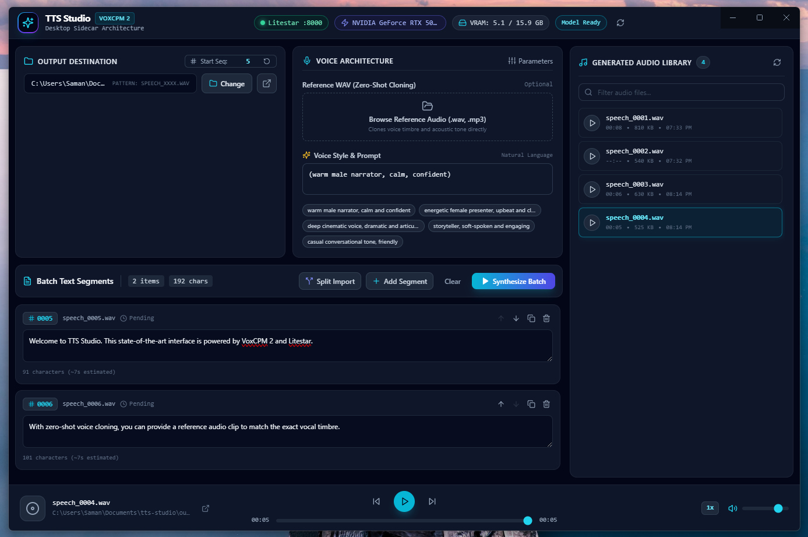

# 🎙️ TTS Studio — VoxCPM 2

A modern, standalone desktop studio for high-quality **Text-to-Speech (TTS)** and **Voice Cloning** powered by [OpenBMB's VoxCPM 2](https://github.com/OpenBMB/VoxCPM). Built with **Electron**, **Vue 3**, and a high-performance **Litestar (Python)** backend sidecar.

---

## ✨ Features

- **⚡ VoxCPM 2 Sidecar Architecture**
  - Integrated Python sidecar powered by [Litestar](https://litestar.dev/) and PyTorch with CUDA acceleration.
  - Automatically spawned, monitored, and cleanly terminated with the Electron desktop app lifecycle.
  - Asynchronous background model weight pre-loading with acoustic fallback mode.

- **📑 Batch TTS Generation**
  - Flexible line-by-line input or bulk paragraph import.
  - Natural sequential naming (`speech_0001.wav`, `speech_0002.wav`, ...).
  - **Smart Sequence Detection**: Automatically detects the highest index in your destination folder to prevent overwriting existing tracks.
  - Drag, duplicate, reorder, and remove individual text segments with live character counts.

- **🎭 Voice Cloning & Customization**
  - **Reference Audio**: Supply any `.wav`, `.mp3`, `.flac`, `.ogg`, or `.m4a` file for instant zero-shot voice cloning.
  - **Style Prompting**: Inject natural language voice style instructions (e.g., `(warm male narrator, calm, confident)`).
  - **Inference Controls**: Adjustable Classifier-Free Guidance (CFG) scale (`0.0`–`5.0`), inference timesteps (`5`–`50`), and denoiser toggle.

- **📊 Real-time Progress & Telemetry**
  - Live progress updates streamed via Server-Sent Events (SSE).
  - Top bar monitoring for GPU hardware status, VRAM consumption (allocated / reserved / total), CUDA availability, and backend readiness.

- **🎵 Built-in Audio Player & File Manager**
  - Audio playback bar with scrubbing, seek, volume control, and variable playback speeds (`0.75x`, `1x`, `1.25x`, `1.5x`, `2x`).
  - Playlist browsing with natural file sorting, duration detection, and one-click "Reveal in Folder".
  - Safe file deletion with confirmation modal dialogs.

- **🌙 Modern Studio UI**
  - Sleek dark theme styled with Tailwind CSS and Lucide icons.
  - Frameless window with custom native titlebar controls.
  

---

## 🛠️ Architecture

```
tts-studio/
├── electron/                 # Electron main and preload processes
│   ├── main.ts               # App lifecycle, sidecar spawn/kill, native dialogs & IPC
│   └── preload.ts            # Context bridge exposing electronAPI to Vue
├── server/                   # Python Litestar TTS sidecar
│   ├── engine.py             # VoxCPM 2 model loader, inference loop & acoustic fallback
│   ├── main.py               # Litestar REST & SSE streaming endpoints (/api/*)
│   └── requirements.txt      # PyTorch, Litestar, torchaudio, voxcpm dependencies
├── src/                      # Vue 3 Frontend
│   ├── components/           # UI components (VoiceConfig, BatchTextInput, AudioPlayerBar, etc.)
│   ├── composables/          # Reactive logic (useBatchTTS, useAudioPlayer)
│   ├── types/                # TypeScript interfaces and types
│   ├── App.vue               # Main layout and studio state orchestration
│   └── main.ts               # Application entry point
├── package.json              # Node dependencies and build scripts
└── vite.config.ts            # Vite + Electron build configuration
```

---

## 📋 Prerequisites

1. **Node.js**: `v18.0.0` or higher (v20+ recommended).
2. **Python**: `3.10` or `3.11` (Python 3.11 recommended).
3. **NVIDIA GPU & CUDA** *(Recommended)*:
   - For fast inference, a CUDA-capable GPU with at least 6–8 GB VRAM is recommended.
   - CPU inference and acoustic fallback modes are supported automatically if CUDA is unavailable.

---

## 🚀 Getting Started

### 1. Clone the Repository

```bash
git clone https://github.com/your-username/tts-studio.git
cd tts-studio
```

### 2. Set Up the Python Backend Sidecar

Create and activate a virtual environment inside the `server/` directory:

**Windows (PowerShell):**
```powershell
cd server
python -m venv .venv
.\.venv\Scripts\activate
pip install -r requirements.txt
cd ..
```

**macOS / Linux:**
```bash
cd server
python3 -m venv .venv
source .venv/bin/activate
pip install -r requirements.txt
cd ..
```

> [!TIP]
> `electron/main.ts` will automatically find and use the Python executable in `server/.venv/` on startup.

### 3. Install Node Dependencies

```bash
npm install
```

### 4. Run Development Mode

Launch the app in development mode with live reloading:

```bash
npm run dev
```

This starts the Vite development server and launches Electron, which automatically spins up the Litestar backend sidecar at `http://127.0.0.1:8000`.

---

## 📦 Available Scripts

| Script | Command | Description |
|---|---|---|
| **Dev** | `npm run dev` | Runs Vite dev server and opens Electron with the sidecar |
| **Build** | `npm run build` | Typechecks with `vue-tsc` and compiles the production bundle |
| **Lint** | `npm run lint` | Runs ESLint across TypeScript and Vue files |
| **Format** | `npm run format` | Formats all code with Prettier |
| **Typecheck** | `npm run typecheck` | Runs TypeScript type checking without emitting files |

---

## 📡 API Endpoints (Python Sidecar)

The backend runs on `http://127.0.0.1:8000`:

| Method | Endpoint | Description |
|---|---|---|
| `GET` | `/api/status` | Returns GPU telemetry, VRAM usage, and model readiness status |
| `POST` | `/api/tts/synthesize` | Synchronous single-file TTS generation |
| `POST` | `/api/tts/batch-stream` | Server-Sent Events (SSE) stream for batch generation progress |
| `GET` | `/api/files/list?directory=...` | Lists and sorts WAV audio files in a specified folder |
| `GET` | `/api/files/audio?path=...` | Streams audio file with HTTP range request support |
| `DELETE` | `/api/files?path=...` | Deletes a specified audio file from disk |

---

## ⚙️ Voice Configuration Guide

- **Voice Prompt**: Instructs the model on acoustic tone, emotion, pacing, and style. Wrap descriptions in parentheses, e.g. `(enthusiastic storyteller, expressive, mid pitch)`.
- **Reference Audio**: When selected, VoxCPM 2 conditions on the timbre and acoustic characteristics of the uploaded reference clip.
- **CFG Scale (Classifier-Free Guidance)**: Controls how strictly the synthesis adheres to the style prompt. Values between `1.5` and `2.5` typically produce natural results.
- **Inference Timesteps**: Higher values improve fidelity and nuance at the cost of synthesis speed (default: `10` steps).
- **Denoise**: Applies a denoising filter to eliminate background artifacts in generated output.

---

## 📄 License

This project is licensed under the [MIT License](LICENSE).
VoxCPM model weights and code are governed by the [OpenBMB VoxCPM License](https://github.com/OpenBMB/VoxCPM).

